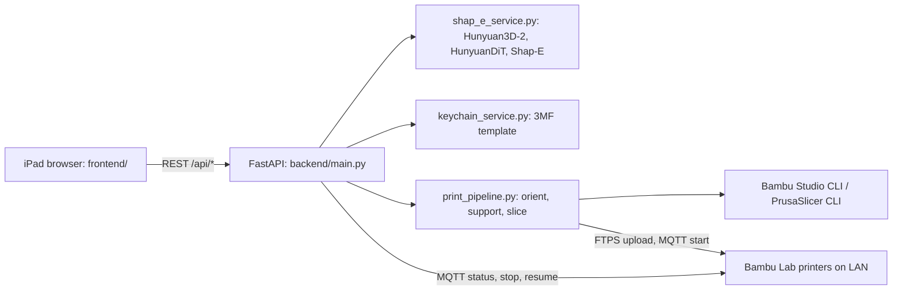

# Bridge PrintMind Studio

Touch-first studio for turning a text prompt, a photo or a name into a 3D-printable model, then slicing it and sending it to Bambu Lab printers on the local network.


> Internal BRIDGE / EDGE Group tool. The UI, logo and keychain template carry company branding; do not distribute outside the organisation.

## Overview

This repository (`Bridge-scan`) contains PrintMind Studio: a FastAPI backend that runs generative 3D models on a local CUDA GPU, slices the result with Bambu Studio (PrusaSlicer as fallback) and drives Bambu Lab printers over their LAN interfaces, plus a single-page web UI laid out for an iPad Pro 12.9" in light or dark mode.

## Features

- **Four ways to create**: *Describe* (text prompt), *Upload* (image file or device camera), *Inspire* (a gallery of 80 reference images in 8 categories) and *Keychain* (a personalised name keychain built from a master 3MF template).
- **Text to 3D**: HunyuanDiT text-to-image followed by Hunyuan3D-2 shape generation, with Shap-E `text300M` as fallback.
- **Image to 3D**: Hunyuan3D-2, with Shap-E `image300M` as fallback; optional `rembg` background removal and mesh clean-up with trimesh.
- **Fast / Balanced / Quality** presets, live progress polling, cancellation and per-run timings (sampling, decode).
- **Preview** in three.js, including a plate view of the 256 × 256 mm Bambu X1C bed, with STL, OBJ and 3MF export.
- **Print settings**: purpose (Balanced, Decor, Durable), target size (35 to 160 mm slider with Small 48, Medium 70 and Large 110 mm presets), support strategy (Auto, On, Off), automatic upright orientation, AMS on/off and slot, auto-start and job name. The UI fixes nozzle (0.4 mm hardened steel), plate (Textured PEI) and calibration flags; the API accepts overrides.
- **Slicing** with the Bambu Studio CLI to 3MF using the X1C system presets, falling back to PrusaSlicer G-code.
- **Production flow**: estimates and preflight checks (plate fit, printer busy, live nozzle mismatch with suggested fixes, AMS availability), FTPS upload and MQTT start, a background job queue that retries while a printer is busy, a status timeline (heating, calibration, first layer, printing) and stop/resume. The API can also auto-route a job to a recommended printer.

## Architecture



## Tech Stack

- **Backend**: Python 3.10, FastAPI, Uvicorn, Pydantic, trimesh, NumPy/SciPy, Pillow, PyTorch (CUDA 12.6 wheels)
- **Generation**: Shap-E (local checkout), Hunyuan3D-2 (`hy3dgen`, optional local checkout), Hugging Face `diffusers`/`transformers` for HunyuanDiT
- **Printers**: `bambulabs_api`, `paho-mqtt`, implicit FTPS; Bambu Studio and PrusaSlicer command-line slicers
- **Frontend**: vanilla JavaScript, HTML and CSS with vendored three.js r160 (`OrbitControls`, `STLLoader`)
- **Tooling**: SDXL-Turbo via `diffusers` to generate the Inspire gallery images

## Getting Started

Prerequisites on a Windows PC: Python 3.10 (64-bit), Git, PrusaSlicer, Bambu Studio and an NVIDIA GPU with CUDA (generation runs in strict GPU mode by default). The code expects this layout:

```
C:\printmind\
├── printmind_app\          # this repository
├── shap-e\                 # Shap-E source checkout (installed with pip -e)
└── hunyuan\Hunyuan3D-2\    # optional; enables the Hunyuan3D-2 pipeline
```

```powershell
cd C:\printmind
py -3.10 -m venv venv310
.\venv310\Scripts\Activate.ps1
python -m pip install --upgrade pip setuptools wheel
pip install torch torchvision torchaudio --index-url https://download.pytorch.org/whl/cu126
pip install -e .\shap-e
pip install -r .\printmind_app\backend\requirements.txt
```

Set the printer and slicer variables below, open a new terminal, then start the server:

```powershell
cd C:\printmind
.\venv310\Scripts\Activate.ps1
cd .\printmind_app\backend
uvicorn main:app --host 0.0.0.0 --port 8000
```

Open `http://<server-hostname>:8000` on the iPad, or check `http://localhost:8000/api/health`. The full copy-paste checklist, including API examples for generate, estimate, print and status, is in [`backend/SETUP_COMMANDS_WINDOWS.txt`](backend/SETUP_COMMANDS_WINDOWS.txt).

## Configuration

Environment variables (names only; set them with `setx` or per session):

| Area | Variables |
| --- | --- |
| Printers | `PRINTER_1_NAME`, `PRINTER_1_IP`, `PRINTER_1_ACCESS_CODE`, `PRINTER_1_SERIAL`, and the same for `PRINTER_2_*` |
| Printer file | `PRINTERS_CONFIG_JSON`: path to a JSON printer list; defaults to the git-ignored `backend/printers.local.json`, which overrides the variables above and can hold more than two printers |
| PrusaSlicer | `PRUSA_SLICER_CONSOLE`, `PRUSA_PROFILE_INI`, `SLICE_DIR` |
| Bambu Studio | `BAMBU_STUDIO_EXE`, `BAMBU_SYSTEM_ROOT`, `BAMBU_MACHINE_JSON`, `BAMBU_PROCESS_DECORATIVE_JSON`, `BAMBU_PROCESS_DURABLE_JSON`, `BAMBU_PROCESS_DRAFT_JSON`, `BAMBU_FILAMENT_PLA_JSON`, `BAMBU_FILAMENT_PLACF_JSON`, `BAMBU_FILAMENT_ABS_JSON` |
| Models | `HUNYUAN_MODEL_ID`, `HUNYUAN_TEXT2IMAGE_ENABLED`, `HUNYUAN_TEXT2IMAGE_MODEL_ID`, `STRICT_GPU_MODE`, `DISABLE_QUALITY_FALLBACK` |
| Start-up | `PREWARM_MODELS`, `PREWARM_TEXT2IMAGE`, `PREWARM_TEXT2IMAGE_KEEP_GPU` |

Printer access codes stay local: keep them in environment variables or `backend/printers.local.json`, never in the repository.

**Security:** the API has no authentication, and `GET /api/printers_admin` returns stored access codes. Run the server only on a trusted network.

## Project Structure

```
├── main.py                       # ASGI shim: adds backend/ and ../shap-e to sys.path, exposes app
├── generate_inspiration_images.py  # SDXL-Turbo generator for the Inspire gallery
├── backend/
│   ├── main.py                   # FastAPI app: REST API, job queue, printer status
│   ├── config.py                 # printer and slicer configuration
│   ├── shap_e_service.py         # text/image to 3D generation
│   ├── keychain_service.py       # personalised keychain 3MF builder
│   ├── print_pipeline.py         # orientation, supports, slicing, upload, start
│   ├── bambu_lan.py              # FTPS upload and MQTT status/commands
│   ├── slicer_bambu.py, slicer_prusa.py, mesh_clean.py, prusaconfig.ini
│   ├── assets/templates/bridge_keychain/  # master keychain 3MF, STEP, F3D and logo
│   └── SETUP_COMMANDS_WINDOWS.txt
└── frontend/
    ├── index.html                # single-page UI
    ├── static/app.js, styles.css
    ├── static/vendor/            # three.js r160, OrbitControls, STLLoader
    ├── static/assets/inspiration/  # gallery images and library.json
    └── tools/build_inspiration_library.py
```

## Team / Credits

- Code committed by Awaiz Ahmed; the app header carries the byline "by Haroon Siddiqui".
- Built on Shap-E (OpenAI), Hunyuan3D-2 and HunyuanDiT (Tencent), three.js, `bambulabs_api`, Bambu Studio and PrusaSlicer.

---

Built by [Awaiz Ahmed](https://github.com/4waiz)
